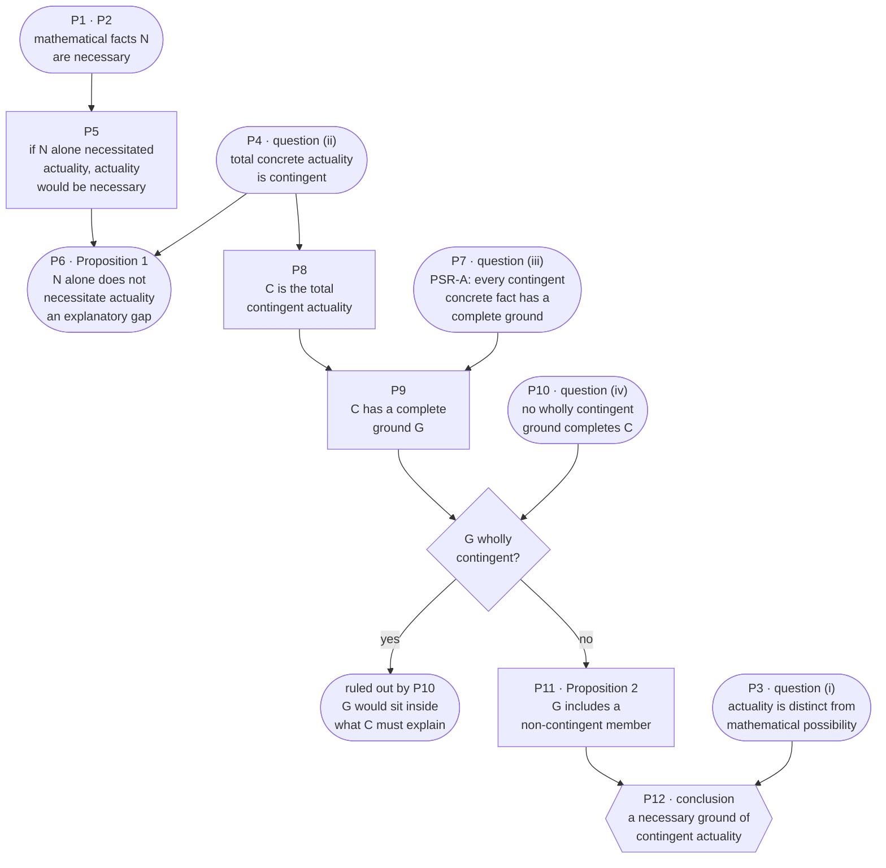
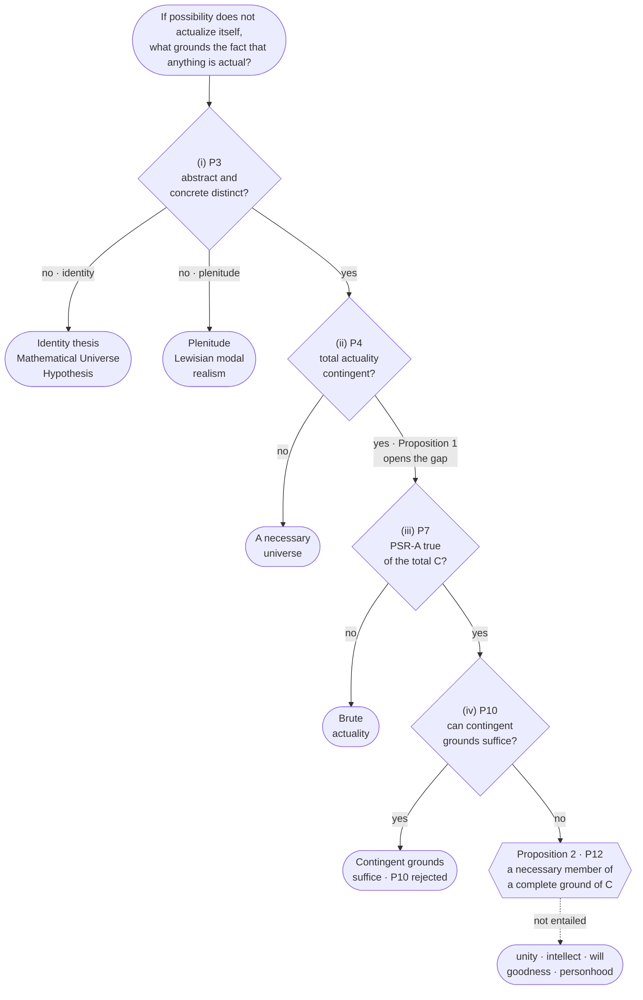
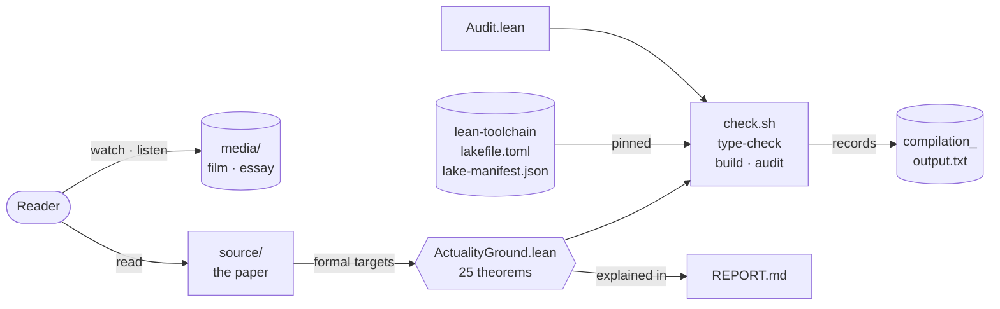
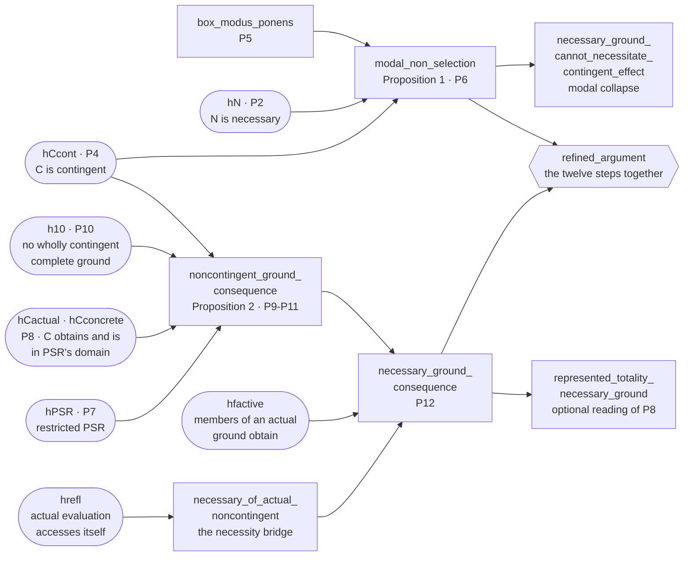
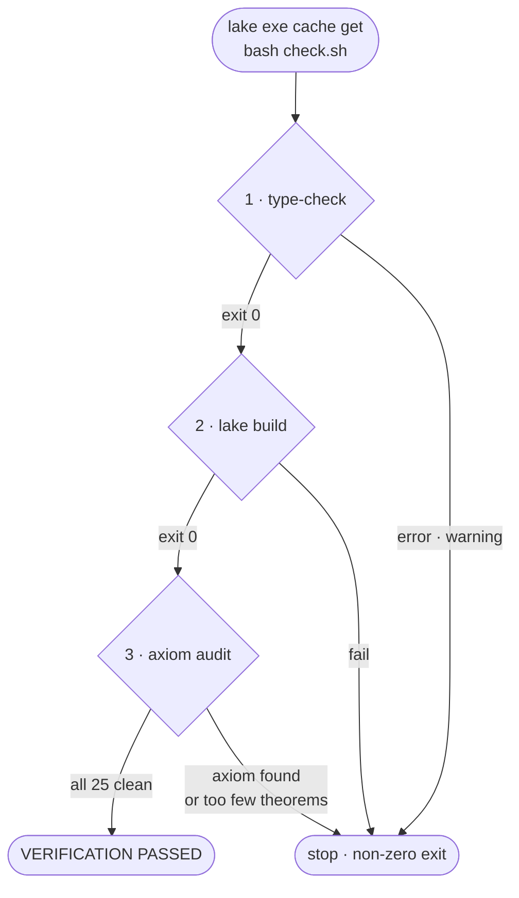

<h1 align="center">From Mathematical Possibility to Actuality</h1>

<p align="center">
  <em>A modal-existential argument for a necessary ground of concrete reality</em><br>
  A Philosophical Reconstruction · 20 September 2026
</p>

<p align="center">
  <a href="source/actuality_and_necessary_ground.pdf"><strong>Read the paper</strong></a>
  &nbsp;·&nbsp;
  <a href="ActualityGround.lean"><strong>Lean 4 development</strong></a>
  &nbsp;·&nbsp;
  <a href="REPORT.md"><strong>Verification report</strong></a>
</p>

<p align="center">
  Lean 4.19.0 &nbsp;·&nbsp; 25 theorems &nbsp;·&nbsp; no added axioms &nbsp;·&nbsp; conditional throughout
</p>

---

> If possibility does not actualize itself, what grounds the fact that anything is actual?

<p align="center">
  <video
    src="media/introduction.mp4"
    poster="media/introduction-poster.jpg"
    controls
    playsinline
    preload="metadata"
    width="820"
    title="Introduction: from mathematical possibility to concrete actuality">
    <a href="media/introduction.mp4">Play the introduction</a>
  </video>
</p>

<p align="center">
  <a href="media/introduction.mp4"><strong>▶ &nbsp;Play the introduction</strong></a>
  &nbsp;·&nbsp; 7 minutes
</p>

A complete physical theory can describe a world in mathematical terms. One may even hold that a physical world *is* a mathematical structure. A prior question remains: what, if anything, distinguishes a mathematically possible structure from a concretely actual reality?

That question is not whether mathematical objects exist, and it is not what event came before the first physical event. In a four-dimensional block, the whole history is one tenseless structure, and asking for an earlier event can be the wrong question. The question is ontological. Why is there concrete actuality at all, rather than only mathematical possibility or abstract structure?

---

## Core thesis

Mathematical truths can specify or characterize possible structures. If concrete actuality is genuinely contingent, necessary mathematical truths alone cannot be a metaphysically sufficient, necessitating ground of that actuality. If contingent actuality has a sufficient ground, its complete ground cannot itself be merely contingent. That motivates a necessary ground of actuality.

The word *motivates* is deliberate. The argument is conditional on substantive metaphysical premises, above all a restricted Principle of Sufficient Reason. It is stronger than a loose intuition, and weaker than a theorem of pure logic.

## Four distinctions

The argument starts only once these are kept apart.

| | |
|---|---|
| **Mathematical and concrete** | The facts that characterize a possible structure, and the fact that some concrete reality is actual. Denying the distinction is already a metaphysics: mathematical monism, full-blooded Platonism, modal realism, or the Mathematical Universe Hypothesis. |
| **Possible and actual** | For a world-description $W$, $\mathrm{Possible}(W)$ need not yield $\mathrm{Actual}(W)$. If every possible world is actual in the same sense, the question moves to the plenitude itself. |
| **Contingent and necessary** | $p$ is contingent when $\Diamond p \land \Diamond \neg p$. The argument needs the contingency of the relevant total actuality, not the contingency of every law, constant, or event. |
| **Description, cause, explanation, ground** | A description represents. A cause relates events or states. An explanation answers a why-question. A ground is metaphysical dependence: one fact obtains in virtue of another. The ground sought here need not be temporally earlier than the world. |

## Why mathematics does not select a world

Let $N$ be the mathematical facts relevant to the structure of a possible world $W$, and suppose those facts are necessary:

$$
\Box N.
$$

Suppose the concrete actuality of $W$ is contingent:

$$
\Diamond \mathrm{Actual}(W) \land \Diamond \neg \mathrm{Actual}(W).
$$

For mathematics *alone* to be a necessitating sufficient ground of that actuality, one would need

$$
\Box (N \to \mathrm{Actual}(W)).
$$

In any normal modal logic, $\Box N$ and that necessary implication yield $\Box \mathrm{Actual}(W)$, which contradicts the contingency of $\mathrm{Actual}(W)$.

<p align="center">
  <strong>Why Math Cannot Create Physical Reality</strong><br>
  <em>A spoken account of this modal core · 46 minutes</em>
</p>

<p align="center">
  <audio
    src="media/Why_Math_Cannot_Create_Physical_Reality_compressed.mp3"
    controls
    preload="metadata"
    style="width: min(720px, 100%);"
    title="Why Math Cannot Create Physical Reality">
    <a href="media/Why_Math_Cannot_Create_Physical_Reality_compressed.mp3">Listen</a>
  </audio>
</p>

<p align="center">
  <a href="media/Why_Math_Cannot_Create_Physical_Reality_compressed.mp3"><strong>▶ &nbsp;Listen</strong></a>
  &nbsp;·&nbsp; 46 minutes
</p>

**Proposition 1 — Modal non-selection.** If the mathematical facts $N$ are necessary and the actuality of $W$ is contingent, then $N$ alone cannot be a metaphysically necessitating sufficient ground of $\mathrm{Actual}(W)$.

The proposition is narrower than “mathematics cannot explain actuality in any sense.” A non-necessitating statistical or contrastive explanation would take further metaphysical work, and would still leave the ultimate explanatory question open.

The same pattern answers the modal-collapse worry. A necessarily obtaining ground cannot, through a necessary implication, necessitate an effect that remains contingent. Contingency survives only if the link from ground to effect is not itself necessary.

## From the gap to a necessary ground

The modal core opens an explanatory gap. Crossing it requires a further principle.

**PSR-A.** Every contingent fact of concrete actuality has a sufficient metaphysical ground or complete explanation.

PSR-A does not say that every truth has a cause, or that necessary truths are caused. It targets contingent concrete actuality.

Let $C$ be the total contingent fact: the conjunction, or totality, of the contingent facts of concrete actuality. The notation need not mean a literal set-theoretic conjunction. It names the whole contingent domain whose actuality is in question. By PSR-A, $C$ has some complete ground $G$.

If $G$ were wholly contingent, it would belong to the very totality it is asked to explain. Its own actuality would remain inside the explanandum. An infinite chain of contingent explanations can be temporally beginningless and still leave that global question: why does the whole contingent structure obtain?

**Proposition 2 — Necessary-ground consequence.** Assume there is a total contingent actuality $C$, PSR-A holds, and no wholly contingent member or collection is a complete ground of that totality. Then the complete ground of $C$ includes at least one non-contingent reality.

The conclusion is modest on purpose. There is a non-contingent ground of contingent actuality. That does not yet establish omniscience, perfect goodness, personhood, or any revealed theology.

The whole argument is one conditional:

$$
(P_3 \land P_4 \land P_7 \land P_{10}) \rightarrow \exists G\ \mathrm{NecessaryGround}(G, C).
$$

## The argument in twelve steps



Stadiums are premises or end states, rectangles are derived steps, the diamond is the case split behind Proposition 2, and the hexagon is the conclusion. The left branch is Proposition 1: it opens an explanatory gap, but P12 does not depend on it. The premises tagged (i) to (iv) are the four places where the paper locates disagreement. In Lean, P12 is stated as a necessary member of a complete ground, with factivity and self-accessibility added as explicit bridges.

1. **P1.** There are mathematical truths and structures capable of characterizing possible worlds.
2. **P2.** At least the relevant pure mathematical truths are necessary.
3. **P3.** Concrete actuality is distinguishable from mere mathematical possibility, unless one adopts a strong identity or plenitude thesis.
4. **P4.** The actuality of the total concrete world is contingent. It could have failed to exist, or could have been otherwise.
5. **P5.** If necessary mathematical truths alone metaphysically necessitated that actuality, the actuality would itself be necessary.
6. **P6.** Therefore necessary mathematical truths alone do not necessitate the contingent actuality of the world.
7. **P7.** Every contingent fact of concrete actuality has a sufficient metaphysical ground or complete explanation. This is PSR-A.
8. **P8.** Let $C$ be the total contingent actuality.
9. **P9.** By P7, $C$ has a complete ground.
10. **P10.** A ground composed wholly of contingent actuality cannot be the ultimate complete ground of the totality of contingent actuality, because its own actuality remains within what was to be explained.
11. **P11.** Therefore the complete ground of $C$ includes a non-contingent reality.
12. **P12.** Hence, conditional on P3, P4, P7, and P10, there is a necessary ground of contingent actuality beyond merely possible mathematical description.

Disagreement belongs at four places: whether the abstract/concrete distinction is genuine; whether total concrete actuality is contingent; whether PSR-A is true; and whether a wholly contingent totality can be completely grounded by contingent reality alone.

## What the argument supports

| Conditional result | Further claim, left open |
|---|---|
| A distinction between mathematical possibility and contingent actuality | That mathematical Platonism is true |
| Necessary mathematical truths cannot alone necessitate contingent actuality | That the universe had a temporal beginning |
| A necessary ground, if PSR-A and the anti-circularity premise are accepted | That Gödel’s theorem proves God |
| A timeless grounding model compatible with a block universe | Any verdict on quantum mechanics |
| A natural bridge to Avicennian and Leibnizian contingency arguments | That the necessary ground is personal, omniscient, or morally perfect |
| A warning against conceiving the ground as one more intraworldly object | That Heidegger endorsed classical theism |

## Voices the reconstruction keeps in tension

**Avicenna.** What is contingent in itself does not contain the sufficient explanation of its existence. The movement is contingent actuality, ontological dependence, non-contingent ground. The further theses of *The Healing* — simplicity, unity, intellect, emanation — are not reproduced here.

**Leibniz.** Even if every event in a series has an earlier explanation, one can still ask why that series exists, and why this one rather than another. The present argument asks why $\mathrm{Actual}(W)$ rather than merely $\mathrm{Possible}(W)$. Understanding, will, and power are not built into the premises.

**Heidegger.** If a necessary ground is posited, it should not be conceived as one more contingent-like object inside the world whose actuality it grounds. The proposal is to speak of a necessary ground of actuality before speaking of a highest object.

**Gödel.** Incompleteness separates a mathematical structure from any one formal theory of that structure. It does not show that a mathematical universe is impossible, and it is not a premise of this argument.

**The block.** If the whole history $`U = \{S(t) : t \in T\}`$ is the candidate concrete object, the question is why $U$ is actual, not what caused the next slice. A ground may satisfy $G \triangleright U$ without a time $t = -1$ at which it switches spacetime on.

## Where the choice remains

The argument does not force a conclusion by logic alone. Each of the four questions has an exit, and each exit bears its own cost.



The tags (i) to (iv) match the questions in the chart. Where the Lean development has a model for an exit, it is named.

- **Identity (i).** Hold that mathematical existence just is concrete existence, as in the strongest form of the Mathematical Universe Hypothesis. The gap is refused by refusing the distinction. The abstract/concrete and causal/non-causal contrasts then have to be rebuilt.
- **Plenitude (i).** Hold that every possible world is concrete, or that “actual” is only indexical, as in Lewisian modal realism. “Why this world?” may lapse. “Why is there a concrete plurality at all?” can remain, and the dispute returns to PSR.
- **A necessary universe (ii).** Deny the contingency of $\mathrm{Actual}(W)$. Modal non-selection then does not apply. The mathematical character of the laws does not by itself establish that necessity. Lean: `dropping_contingency_allows_necessitation`.
- **Brute actuality (iii).** Reject PSR-A. The total concrete reality is a fact with no further explanation. No contradiction falls out of pure logic. The cost is that explanation stops at the most comprehensive contingent fact. Lean: `dropping_PSR_countermodel`.
- **Contingent grounds suffice (iv).** Reject P10. A wholly contingent ground may completely ground the total, so PSR and factivity hold with no necessary member. P10 is a strong substantive premise, not something deduced from the word “ground.” Lean: `dropping_P10_countermodel`.
- **A non-contingent ground.** Accept P3, P4, P7, and P10. What follows is a necessary component of a complete ground of contingent actuality. Unity, simplicity, intellect, will, goodness, and personhood each require a further argument. Lean: `necessary_ground_consequence`, and `joint_premises_satisfiable` shows that the premises have a model.

## Repository map



| Component | Role |
|---|---|
| [`source/actuality_and_necessary_ground.pdf`](source/actuality_and_necessary_ground.pdf) | The paper, unchanged |
| [`source/article_extracted.txt`](source/article_extracted.txt) | Page-labelled text extraction of the paper |
| [`ActualityGround.lean`](ActualityGround.lean) | The modal model, the 25 theorems, and the models and countermodels |
| [`Audit.lean`](Audit.lean) | Transitive axiom audit of every theorem |
| [`check.sh`](check.sh) | One command: type-check, build, audit |
| [`lean-toolchain`](lean-toolchain) · [`lakefile.toml`](lakefile.toml) · [`lake-manifest.json`](lake-manifest.json) | Pin Lean 4.19.0 and mathlib `c44e0c8…` |
| [`compilation_output.txt`](compilation_output.txt) | Recorded run of 18 October 2026 |
| [`REPORT.md`](REPORT.md) | Premises, scope, and models, stated precisely |
| [`media/introduction.mp4`](media/introduction.mp4) | The introduction film, 7 minutes |
| [`media/Why_Math_Cannot_Create_Physical_Reality_compressed.mp3`](media/Why_Math_Cannot_Create_Physical_Reality_compressed.mp3) | The spoken essay, 46 minutes |

## The Lean formalization

[`ActualityGround.lean`](ActualityGround.lean) verifies the conditional reasoning. Theorems quantify over a modal model and take the philosophical premises as arguments. They do not prove that the actual universe satisfies PSR, contingency, or the prohibition on wholly contingent complete grounds.

Propositions are functions from evaluations to `Prop`. Grounding candidates form a separate rigid domain: `holds g w` expresses obtaining, and Lean’s type inhabitation is not used as concrete existence. A ground is a mathlib `Set`, and may be infinite. “Wholly contingent” means that every member is contingent. The last step is therefore a **necessary component of a complete ground**, not the necessity of the whole collection, of every member, or of the explanatory relation.

Necessity is relative to worlds accessible from the designated evaluation. Proposition 1 needs no seriality, transitivity, symmetry, or S5. The step from actual non-contingency to necessity uses only accessibility of the actual evaluation from itself.

Philosophical premises enter as hypotheses, never as axioms. In the chart below, stadiums are those hypotheses, named as in the Lean source. Rectangles and the hexagon are theorems, and arrows show which hypotheses and earlier results each theorem uses.



Three helper lemmas are folded into the chart. `modal_non_selection` also uses `contingent_not_necessary`. `noncontingent_ground_consequence` uses `noncontingent_component_of_complete_ground`, which is the P11 step. `represented_totality_necessary_ground` uses `total_fact_actual` and `total_fact_contingent`.

| Source | Theorem | What is verified |
|---|---|---|
| P5 | `box_modus_ponens` | Necessary $N$, and necessary implication, yield a necessary consequent. |
| Proposition 1 / P6 | `modal_non_selection` | Necessary $N$ and contingent $C$ rule out a necessary implication from $N$ to $C$. |
| Modal collapse, p. 10 | `necessary_ground_cannot_necessitate_contingent_effect` | The same form: a necessary ground cannot necessitate a contingent effect. |
| Proposition 2 / P9–P11 | `noncontingent_ground_consequence` | Actual contingent concrete $C$, PSR-A, and P10 yield a complete ground with a non-contingent member. |
| Necessity bridge | `necessary_of_actual_noncontingent` | An actually obtaining non-contingent proposition is necessary, if the actual evaluation accesses itself. |
| P12 | `necessary_ground_consequence` | With factivity, some complete ground contains a member that actually and necessarily obtains. |
| The twelve steps together | `refined_argument` | Non-selection and the necessary-component result hold jointly under their listed premises. |
| Optional reading of P8 | `total_fact_actual`, `total_fact_contingent`, `represented_totality_necessary_ground` | The conjunction of represented actual contingent facts is actual, and contingent if it has a contingent member. The ground result follows if PSR-A and P10 cover that total. |

Factivity is stated separately. A complete actual ground’s members actually obtain. Without that premise, “non-contingent” includes the impossible and does not yield necessary existence. Grounding remains an uninterpreted relation. It is not defined as necessary implication, and it does not encode a physical block-universe theory.

The development also proves the boundaries. Possibility can hold without actuality. Drop contingency, and mathematical necessitation is consistent. Drop PSR, and brute contingent actuality has no ground. Drop P10, and only contingent grounds remain. Drop factivity, and a non-contingent ground may be impossible. The premises of the main theorem are jointly satisfiable, including with contingent effects. A necessary component can coexist with a collection that, taken as a whole, obtains contingently. An extra theological attribute can be false in a model of the premises.

[`Audit.lean`](Audit.lean) checks the transitive axiom dependencies of all 25 theorems. Nineteen depend on no axioms. Six use only Lean’s `propext`, `Classical.choice`, and `Quot.sound`. There are no project axioms and no admitted proofs. The record of the 18 October 2026 run is in [`compilation_output.txt`](compilation_output.txt) and [`REPORT.md`](REPORT.md).

## Reproduce

The project pins Lean `4.19.0` and mathlib commit `c44e0c8ee63ca166450922a373c7409c5d26b00b` (mathlib tag `v4.19.0`). Transitive revisions are in [`lake-manifest.json`](lake-manifest.json).

With Git and [elan](https://lean-lang.org/install/manual/) installed:

```sh
lake exe cache get Mathlib.Data.Set.Basic
bash check.sh 2>&1 | tee compilation_output.txt
```

On Windows, without Bash:

```powershell
lake exe cache get Mathlib.Data.Set.Basic
lake env lean --version
lake env lean -DwarningAsError=true ActualityGround.lean
lake build
lake env lean -DwarningAsError=true Audit.lean
```

`lake exe cache get` fetches `Mathlib.Data.Set.Basic` and its dependencies. Background is in the [mathlib dependency instructions](https://github.com/leanprover-community/mathlib4/wiki/Using-mathlib4-as-a-dependency).

`check.sh` first records the environment: UTC time, toolchain, compiler, mathlib revision, and SHA-256 hashes of the sources. It then runs three gates in order, and `set -euo pipefail` stops it at the first failure.



| Gate | Command | Stops when |
|---|---|---|
| 1 · type-check | `lake env lean -DwarningAsError=true ActualityGround.lean` | any error or warning |
| 2 · build | `lake build` | the build fails |
| 3 · axiom audit | `lake env lean -DwarningAsError=true Audit.lean` | the project declares an axiom, a theorem depends on an axiom other than `propext`, `Classical.choice`, or `Quot.sound`, or fewer than 25 theorems are found |

---

The central question, once more: if possibility does not actualize itself, what grounds the fact that anything is actual?
